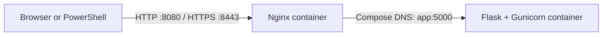

# OpsPulse

OpsPulse is a small containerized service health dashboard built to practice Docker, Docker Compose networking, reverse proxies, automated tests, linting, CI, and local HTTPS.

## Architecture



Nginx is the only service exposed to the host. Flask listens on port `5000` inside the Compose network and is not published as a host port. The Flask container runs as the non-root `app` user.

## Endpoints

| Method | Path | Description |
| --- | --- | --- |
| GET | `/` | Simple service status page |
| GET | `/health` | Returns HTTP 200 when the application responds |
| GET | `/ready` | Returns HTTP 200 when the application is ready |
| GET | `/api/status` | Returns JSON status and application version |

The default version is `0.1.0`. Compose sets `APP_VERSION` for the application.

## Run with Docker Compose

Requirements: Docker Desktop with the Linux engine and Docker Compose.

From the project directory, generate a local self-signed HTTPS certificate once. The certificate and key are kept locally and are not stored in Git.

```powershell
$certDirectory = Join-Path (Get-Location).Path "nginx\certs"
New-Item -ItemType Directory -Path $certDirectory -Force

docker run --rm --mount "type=bind,source=$certDirectory,target=/certs" alpine:3.22 sh -c "apk add --no-cache openssl && openssl req -x509 -nodes -days 365 -newkey rsa:2048 -keyout /certs/opspulse.key -out /certs/opspulse.crt -subj '/CN=localhost' -addext 'subjectAltName=DNS:localhost,IP:127.0.0.1'"
```

Start the application:

```powershell
docker compose up --build
```

Open [http://localhost:8080](http://localhost:8080) or [https://localhost:8443](https://localhost:8443). The HTTPS certificate is self-signed, so your browser may show a security warning during this local exercise.

Check the health endpoint from PowerShell:

```powershell
curl.exe -i http://localhost:8080/health
curl.exe -k -i https://localhost:8443/health
```

The `-k` option tells `curl` to accept the local self-signed certificate for this test.

To stop the services, press `Ctrl+C` if Compose is running in the foreground. If you started it in the background with `-d`, run:

```powershell
docker compose down
```

Check service state and logs:

```powershell
docker compose ps
docker compose logs app
docker compose logs nginx
```

## Run locally with Python

Create a virtual environment and install the development dependencies:

```powershell
py -3.12 -m venv .venv
.\.venv\Scripts\python.exe -m pip install -r requirements-dev.txt
```

Start Flask for local development:

```powershell
.\.venv\Scripts\python.exe -m flask --app app run --host 127.0.0.1 --port 5000
```

Open [http://127.0.0.1:5000](http://127.0.0.1:5000). Stop the local server with `Ctrl+C`.

## Tests and linting

Run the test suite:

```powershell
.\.venv\Scripts\python.exe -m pytest -q
```

Run Ruff:

```powershell
.\.venv\Scripts\ruff.exe check .
```

## CI workflow

GitHub Actions runs on pushes and pull requests. It installs the development dependencies, runs Ruff and pytest, builds the Docker image, generates a temporary self-signed HTTPS certificate, and starts the Compose services. It then makes smoke requests to `/health` over HTTP and HTTPS and shuts down the Compose services when the job finishes.

When CI succeeds on a push to `main`, a separate job publishes the Docker image to GHCR with `latest` and commit-specific tags. Pull requests run the CI checks but do not publish images. Publishing delivers a container image; it does not deploy a running application.

## Published Docker image

After CI passes on a push to `main`, GitHub Actions publishes a public image to GHCR with `latest` and commit-SHA tags.

Pull the latest image:

```powershell
docker pull ghcr.io/kristinajakovceska/opspulse:latest
```

Pulling downloads the image to Docker Desktop. It does not start a container.

## Troubleshooting

### Port 8080 or 8443 is already in use

Nginx ports are bound to 127.0.0.1, so they are available only from this computer. The current mappings are configured in compose.yaml:
```yaml
ports:
  - "127.0.0.1:8080:80"
  - "127.0.0.1:8443:443"
```

If either host port is occupied, change the left side to another free port. For example:

```yaml
ports:
  - "127.0.0.1:8081:80"
  - "127.0.0.1:8444:443"
```

Then use `http://localhost:8081` and `https://localhost:8444`.

### Nginx shows 502 Bad Gateway

Check whether the app is healthy and inspect both services' logs:

```powershell
docker compose ps
docker compose logs app
docker compose logs nginx
```

Nginx reaches Flask by the Compose service name `app` on port `5000`.

### Flask is not reachable at localhost:5000

This is expected when using Docker Compose. Flask is only available inside the Compose network. Send requests through Nginx at `http://localhost:8080` or `https://localhost:8443`.

### HTTPS certificate files are missing

Generate the local certificate and key using the instructions in [Run with Docker Compose](#run-with-docker-compose). The `nginx/certs` directory is ignored by Git, so these files are created separately on each machine.

### Docker cannot connect to its engine

Open Docker Desktop and wait for the engine to start. Check that Docker is using its Linux engine:

```powershell
docker info --format '{{.OSType}}'
```

The expected output is `linux`.